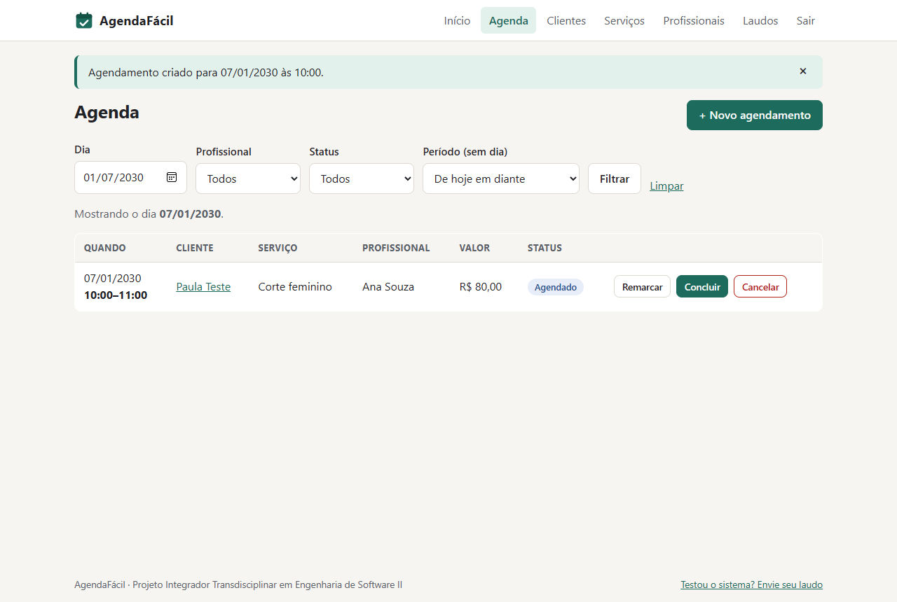

# AgendaFácil

Sistema web de **agendamento para pequenos negócios de serviços** (salões, barbearias, esmalterias). Desenvolvido no **Projeto Integrador Transdisciplinar em Engenharia de Software II**.

O sistema organiza clientes, serviços, profissionais e a agenda e **impede automaticamente** os erros mais comuns de quem marca horário no caderno ou pelo WhatsApp: dois clientes no mesmo horário, horário fora do expediente e cancelamento que não pode ser desfeito.

| | |
|---|---|
| **Sistema no ar** | https://agendafacil-scyw.onrender.com |
| **Formulário de teste** | https://agendafacil-scyw.onrender.com/feedback |
| **Vídeo de apresentação** | *(link do YouTube)* |
| **Vídeo da versão atualizada** | *(link do YouTube)* |



## Funcionalidades

- Conta de usuário com login; a primeira conta vira administradora.
- Clientes: cadastro, busca por nome, telefone ou e-mail, ficha com histórico.
- Serviços (duração e preço) e profissionais, que podem ser desativados em vez de apagados.
- Agendamento com **término calculado**, **horários ocupados em tempo real** e bloqueio de conflito (profissional e cliente), passado, domingo e fora do horário.
- Agenda com filtros; remarcar, concluir, cancelar e **reabrir**.
- Painel do dia: atendimentos, pendentes e receita prevista.
- Formulário público de **laudo de teste** com captura de tela, exportação em CSV.
- Interface responsiva (celular e computador), acessível e com modo escuro automático.

## Tecnologias

| Camada | Tecnologia |
|---|---|
| Back-end | **Python 3.12 + Flask 3**, padrão **MVC** |
| Banco de dados | **PostgreSQL** (Neon) via SQLAlchemy; SQLite nos testes |
| Front-end | HTML5, CSS3 e JavaScript puro (templates Jinja2) |
| Hospedagem | **Render** (Web Service Python com gunicorn); compatível também com Vercel |
| Testes | pytest, pytest-cov, Playwright: **125 testes, 94% de cobertura** |
| Modo de codificação | Tradicional |

## Rodar localmente

```bash
python -m venv .venv
.venv\Scripts\activate            # Windows  (Linux/macOS: source .venv/bin/activate)
pip install -r requirements-dev.txt
flask --app agendafacil run --debug
```

Acesse http://127.0.0.1:5000. Testes: `pytest --cov=agendafacil`.

Publicação no Render + Neon: veja [docs/situacao-2/03-instalacao-e-deploy.md](docs/situacao-2/03-instalacao-e-deploy.md).

## Documentação

A documentação está organizada por Situação-Problema da disciplina em [`docs/`](docs/README.md):

| Situação | Conteúdo |
|---|---|
| [1: Revisão do planejamento](docs/situacao-1/) | [Escopo](docs/situacao-1/01-escopo-revisado.md) · [Requisitos e regras](docs/situacao-1/02-requisitos.md) · [UML](docs/situacao-1/03-modelagem-uml.md) · [IHC](docs/situacao-1/04-ihc.md) · [Banco de dados e dicionário](docs/situacao-1/05-banco-de-dados.md) · [schema.sql](docs/situacao-1/schema.sql) |
| [2: Desenvolvimento](docs/situacao-2/) | [Arquitetura MVC](docs/situacao-2/01-arquitetura.md) · [Manual de uso](docs/situacao-2/02-manual-de-uso.md) · [Instalação e deploy](docs/situacao-2/03-instalacao-e-deploy.md) · [Testes automatizados](docs/situacao-2/04-testes-automatizados.md) |
| [3: Testes e validação](docs/situacao-3/) | [Plano de testes](docs/situacao-3/01-plano-de-testes.md) · [Modelo de laudo](docs/situacao-3/02-template-laudo-de-teste.md) · [Laudo de qualidade](docs/situacao-3/03-laudo-de-qualidade.md) · [Roteiro dos vídeos](docs/situacao-3/04-roteiro-dos-videos.md) · [Evidências](docs/situacao-3/evidencias/) |

## Estrutura

```
agendafacil/
  models/        Model: entidades e regras de negócio
  controllers/   Controller: rotas (Blueprints)
  views/         View: templates HTML
  static/        CSS, JavaScript e imagens
wsgi.py          entrada do servidor (Render/gunicorn)
api/index.py     entrada alternativa para o Vercel
tests/           unidade, integração e e2e/
docs/            documentação por Situação-Problema
```
