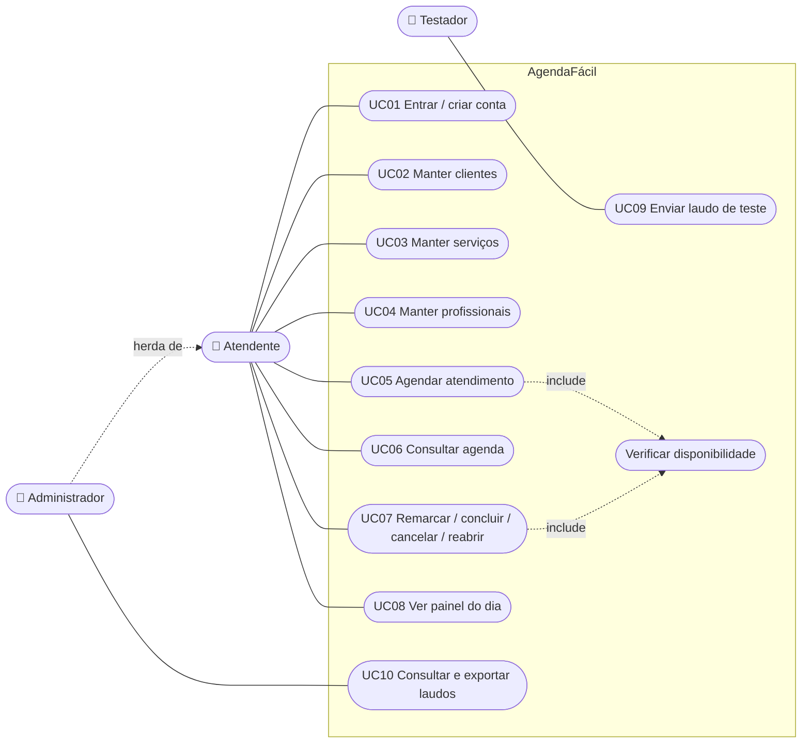
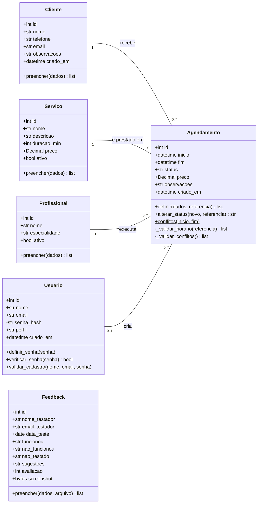
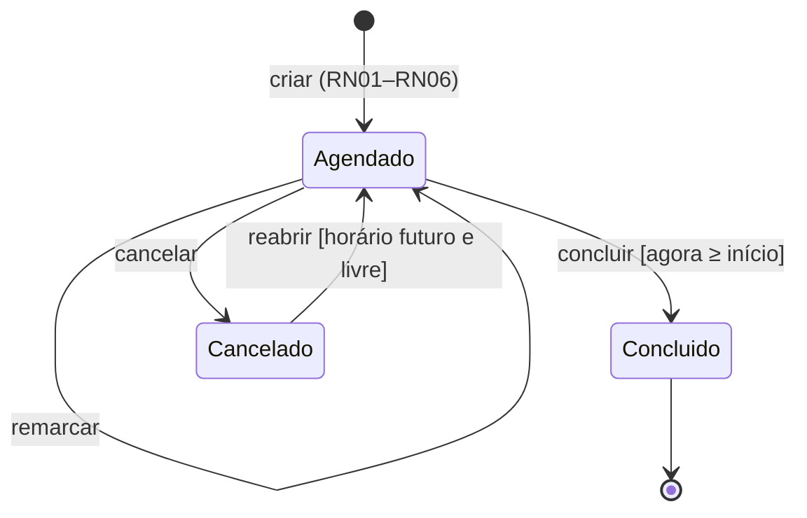
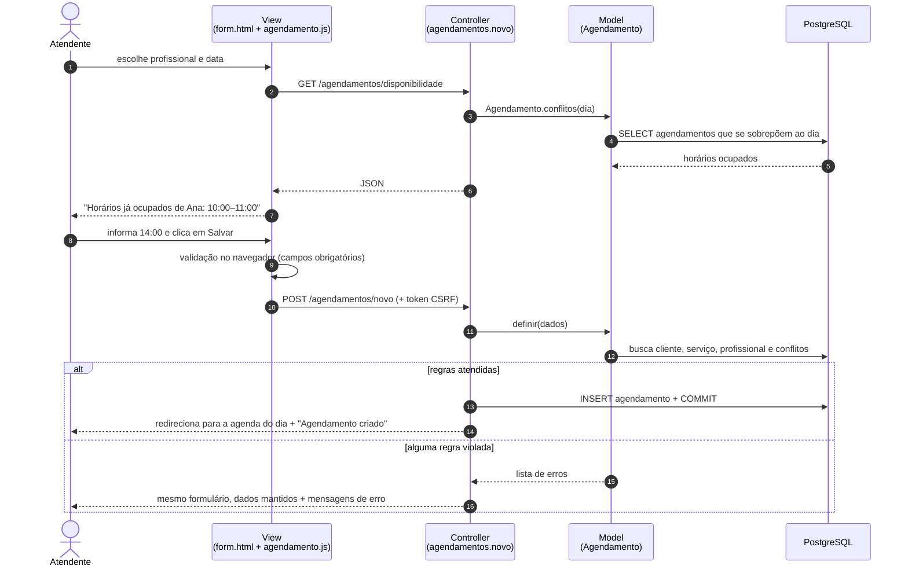
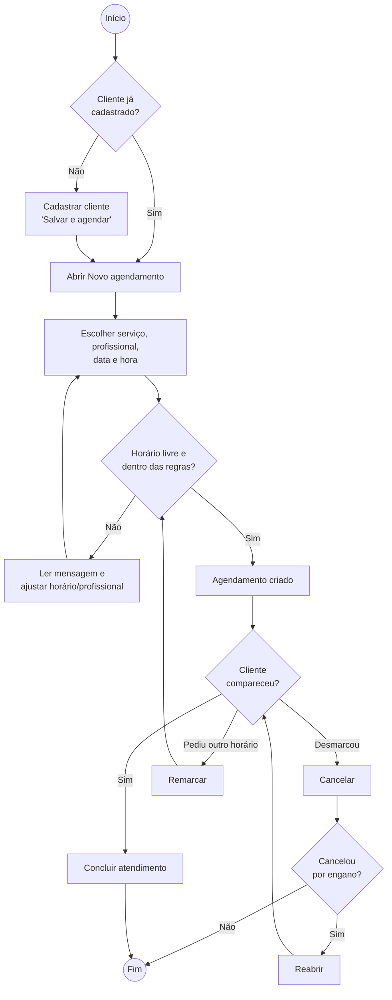

# 3. Modelagem UML (revisada)

Os diagramas estão em [Mermaid](https://mermaid.js.org/), que o GitHub desenha automaticamente. Assim os diagramas ficam versionados junto com o código.

**Revisões em relação ao planejamento inicial:**
- O diagrama de classes ganhou os **métodos** que guardam as regras de negócio (`definir`, `alterar_status`, `conflitos`), e não só os atributos.
- Entrou a classe **Profissional**. Sem ela não dá para verificar conflito de horário quando há mais de uma pessoa atendendo.
- O **preço** passou a ser gravado também no `Agendamento`, para preservar o histórico (RN07).
- Foram incluídos o **diagrama de estados** do agendamento, que deixa explícitas as transições permitidas (RN08), e o **diagrama de sequência** do caso de uso principal.

## 3.1 Diagrama de casos de uso

### Especificação do caso de uso principal: UC05 Agendar atendimento

| Item | Descrição |
|---|---|
| Ator | Atendente (ou Administrador) |
| Pré-condições | Usuário autenticado; existe ao menos um serviço e um profissional ativos |
| Fluxo principal | 1. O ator abre "Novo agendamento". 2. Escolhe cliente, serviço e profissional. 3. Informa data e horário. 4. O sistema mostra o horário previsto de término e os horários já ocupados do profissional. 5. O ator salva. 6. O sistema valida as regras RN01–RN06, grava e mostra a agenda do dia com a mensagem de sucesso. |
| Fluxo alternativo A1 | Cliente não cadastrado: o ator usa "Cadastrar novo cliente" e depois "Salvar e agendar", que volta ao formulário com o cliente já escolhido. |
| Fluxo de exceção E1 | Conflito de horário (RN03/RN04): o sistema não grava, informa com quem e em que horário é o conflito e mantém os dados digitados. |
| Fluxo de exceção E2 | Horário inválido (RN01/RN02): o sistema explica a regra (ex.: "terminaria às 20:30") e mantém os dados. |
| Pós-condição | Agendamento gravado com status **agendado**, preço do serviço copiado e usuário criador registrado. |

## 3.2 Diagrama de classes (modelo de domínio / persistência)

`Feedback` é independente das demais: guarda os laudos dos testadores (Situação 3).

## 3.3 Diagrama de estados: Agendamento

## 3.4 Diagrama de sequência: UC05 Agendar atendimento (padrão MVC)

## 3.5 Diagrama de atividades: atender um cliente no dia

