# 4. IHC: Interface Humano-Computador (revisada)

## 4.1 Princípios do material aplicados na interface

| Princípio (material teórico) | Como aparece no AgendaFácil |
|---|---|
| **Clara** | Rótulos em português simples ("Horário de início", "Telefone (com DDD)"); textos de ajuda abaixo dos campos com exemplos ("Ex.: (11) 98765-4321"); campos obrigatórios marcados com `*`. |
| **Consistente** | Todas as telas de cadastro seguem o mesmo padrão: trilha de navegação, título, campos, botões "Cancelar" (secundário) e "Salvar" (primário) à direita. Cores fixas por significado: verde = ação principal ou sucesso, vermelho = destrutivo ou erro, azul = informação. |
| **Simples** | Somente o necessário em cada tela. Divulgação progressiva: o roteiro de teste fica recolhido em "Sugestão de roteiro"; o filtro "Período" só importa quando não há dia escolhido. |
| **Controlada pelo usuário** | Nada acontece sozinho: as mensagens não somem sozinhas (ver defeito D2 no laudo); o usuário fecha quando quiser. |
| **Direta** | Causa e efeito visíveis: ao escolher serviço e hora, aparece "Término previsto: 11:00 (60 min)"; ao escolher profissional e data, aparecem os horários ocupados. |
| **Empática, recuperável e reversível** | Cancelar não apaga: o agendamento pode ser **reaberto**. Excluir pede confirmação. Itens com histórico são desativados em vez de excluídos. Em caso de erro, o formulário volta preenchido com o que foi digitado. |
| **Dá resposta (feedback)** | Toda ação mostra uma mensagem (sucesso, erro ou aviso), anunciada a leitores de tela (`aria-live`). O botão de envio é desabilitado depois do clique para evitar envio duplicado. |
| **Esteticamente agradável** | Paleta sóbria, cartões com bastante respiro, tipografia do sistema, ícone próprio e modo escuro automático (segue o sistema operacional). |
| **Padrões / valores pré-preenchidos** | Data do agendamento começa em hoje; duração de serviço novo começa em 30 min; data do teste começa em hoje; cliente vem pré-selecionado ao agendar a partir da ficha dele. |

## 4.2 Elementos de interface usados

- **Controles de entrada**: campos de texto, e-mail, telefone (com máscara), número, data, hora, listas suspensas, botões de opção (avaliação de 1 a 5), envio de arquivo.
- **Navegação**: menu principal com item atual destacado (`aria-current`), trilha de navegação ("Clientes › Editar cliente"), campo de pesquisa, paginação, menu recolhível no celular.
- **Informativos**: alertas (sucesso, erro, aviso, info), selos de status (Agendado, Concluído, Cancelado), indicadores do painel, painel de disponibilidade, janela modal de confirmação.
- **Recipientes**: cartões, tabelas que viram cartões no celular, lista do tipo linha do tempo.

## 4.3 Mapa de navegação

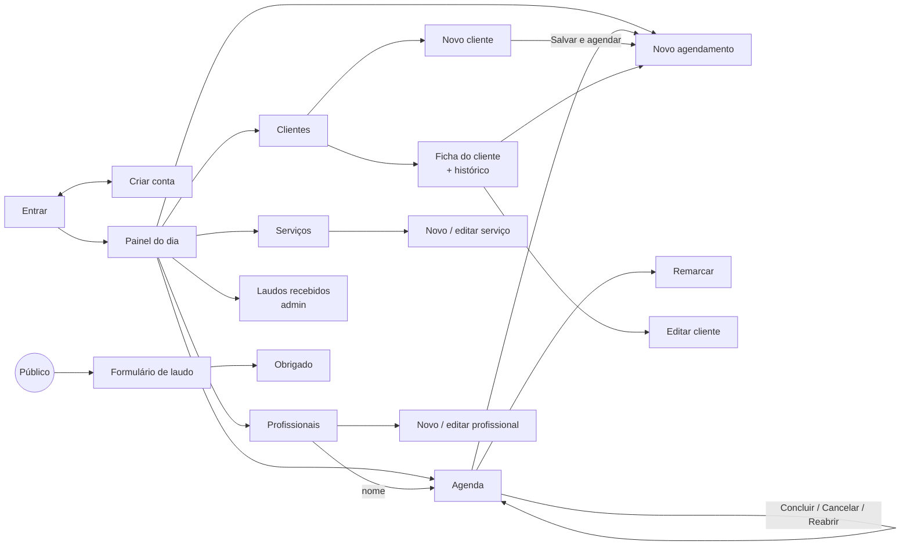

## 4.4 Mapa conceitual do domínio

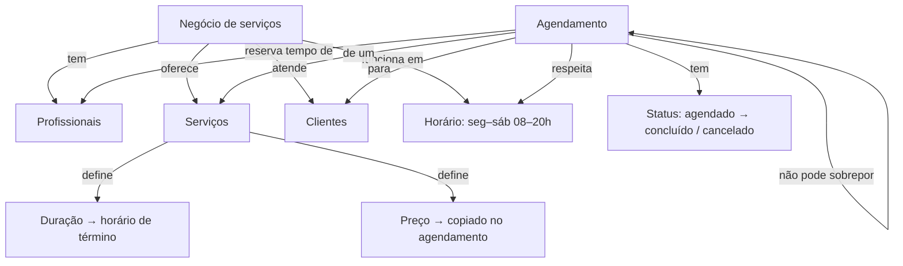

## 4.5 Telas (protótipo implementado)

As capturas abaixo foram geradas automaticamente pelo teste ponta a ponta (`tests/e2e/test_fluxos.py`) em navegador real.

| Tela | Captura |
|---|---|
| Entrar | 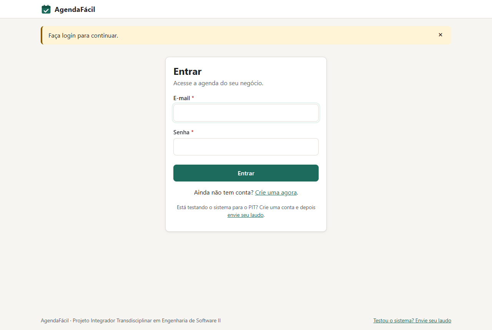 |
| Painel com "Primeiros passos" | 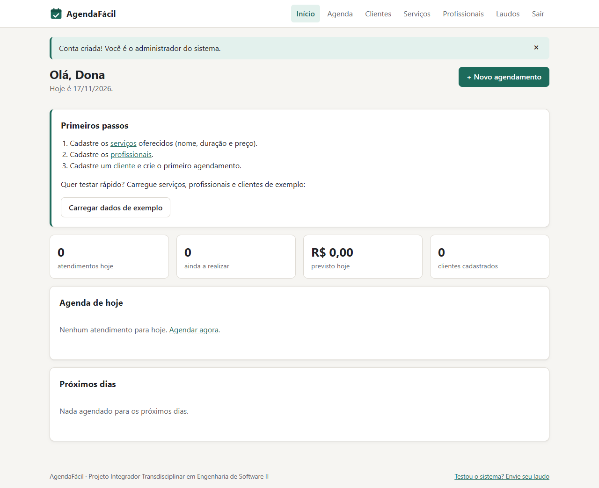 |
| Validação de formulário | 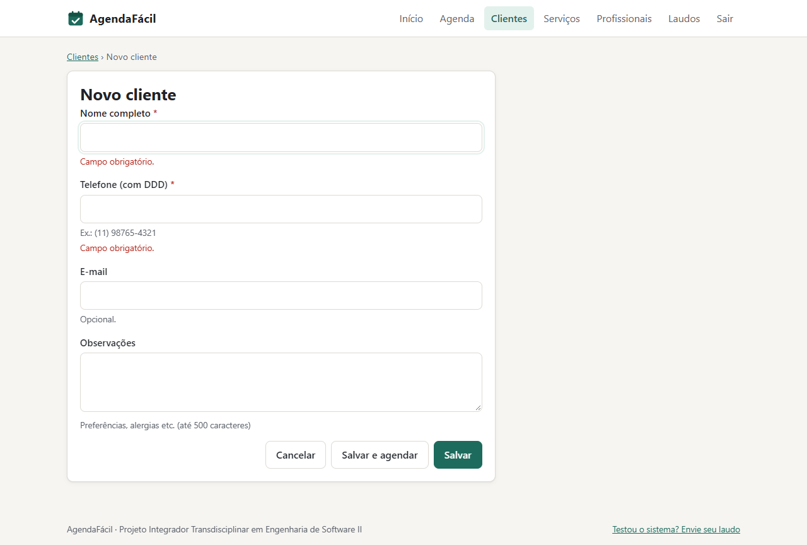 |
| Novo agendamento com término previsto e disponibilidade | 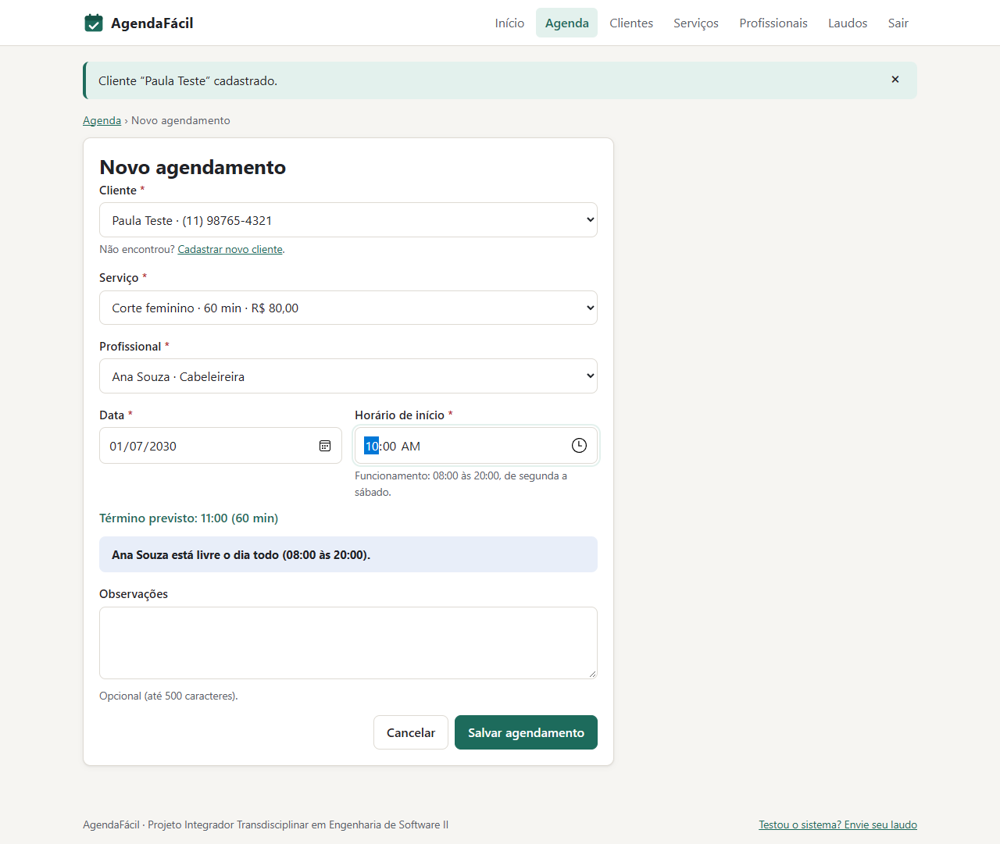 |
| Agenda do dia | 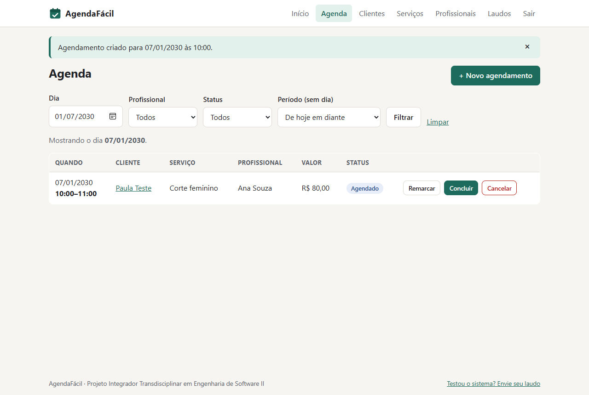 |
| Conflito de horário | 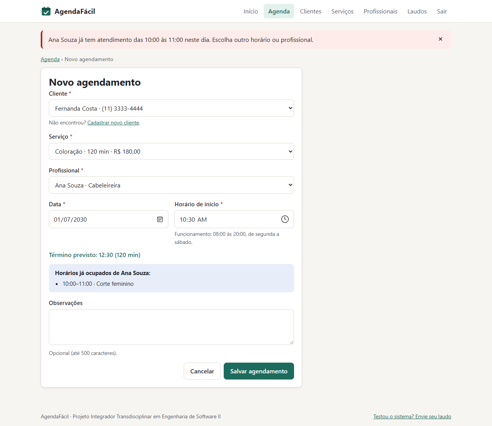 |
| Confirmação antes de cancelar | 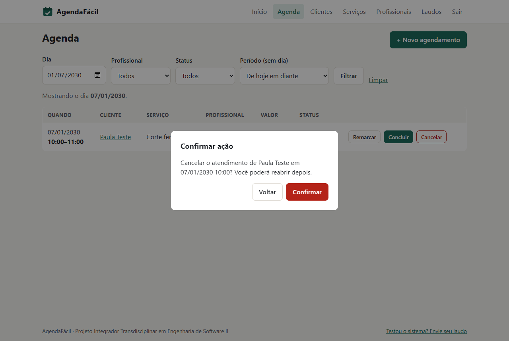 |
| Celular | 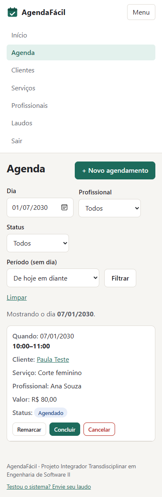 |
| Laudos recebidos (admin) | 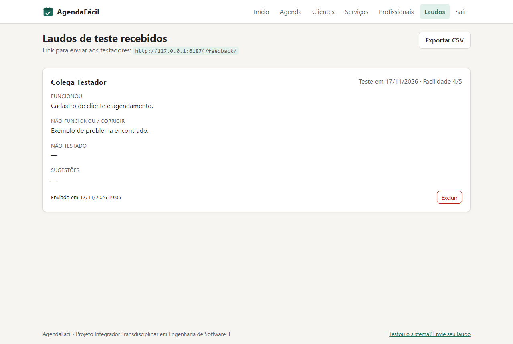 |
| Página de erro 404 | 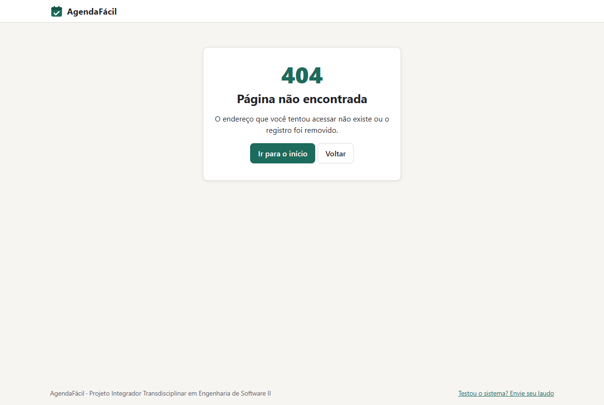 |

## 4.6 Catálogo de mensagens

Toda mensagem diz **o que aconteceu** e, quando é erro, **o que fazer**.

### Sucesso
| Situação | Mensagem |
|---|---|
| Conta criada (1ª) | Conta criada! Você é o administrador do sistema. |
| Cliente salvo | Cliente “Mariana” cadastrado. |
| Agendamento criado | Agendamento criado para 07/01/2030 às 10:00. |
| Cancelamento | Agendamento cancelado. Se foi engano, use “Reabrir”. |
| Serviço editado | Serviço atualizado. Agendamentos já marcados mantêm o preço e a duração originais. |

### Erros de regra de negócio (servidor)
| Regra | Mensagem |
|---|---|
| RN01 | Não é possível agendar em uma data/horário que já passou. |
| RN02 | O estabelecimento não abre aos domingos. / Fora do horário de funcionamento (08:00 às 20:00). Este serviço terminaria às 20:30. |
| RN03 | Ana Souza já tem atendimento das 10:00 às 11:00 neste dia. Escolha outro horário ou profissional. |
| RN04 | O cliente já tem outro agendamento das 10:00 às 11:00. |
| RN09 | Só é possível concluir um atendimento depois do horário de início. / Não é possível reabrir: o horário deste agendamento já passou. |
| RN10 | “Mariana Alves” tem 2 agendamento(s) no histórico e não pode ser excluído. / “Corte” já foi usado em agendamentos. Use “Desativar” em vez de excluir. |
| RN11 | O serviço “Corte” está desativado. |
| RN14 | Telefone deve ter DDD + número (10 ou 11 dígitos). / Já existe um serviço com este nome. / Preço inválido. Use um valor como 35,00. |
| Login | E-mail ou senha incorretos. *(não diz qual dos dois, por segurança)* |

### Erros de preenchimento (navegador, ao lado do campo)
Campo obrigatório. · Digite um e-mail válido, ex.: nome@dominio.com. · Use pelo menos 6 caracteres. · As senhas não conferem. · Telefone com DDD, ex.: (11) 98765-4321. · O valor mínimo é 5. · A imagem deve ter no máximo 2 MB.

### Páginas de erro
| Código | Título | Mensagem |
|---|---|---|
| 400 | Requisição inválida | Sua sessão expirou ou o formulário é inválido. Recarregue a página e tente novamente. |
| 403 | Acesso negado | Você não tem permissão para acessar esta página. |
| 404 | Página não encontrada | O endereço que você tentou acessar não existe ou o registro foi removido. |
| 413 | Arquivo muito grande | O arquivo enviado passa do limite de 2 MB. Reduza a imagem e tente de novo. |
| 500 | Erro interno | Algo deu errado do nosso lado. Tente novamente em instantes. |
