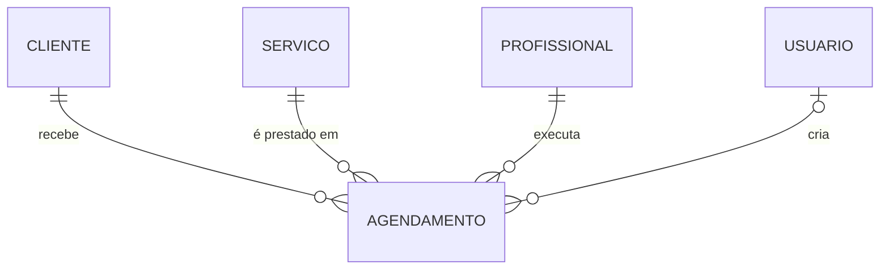
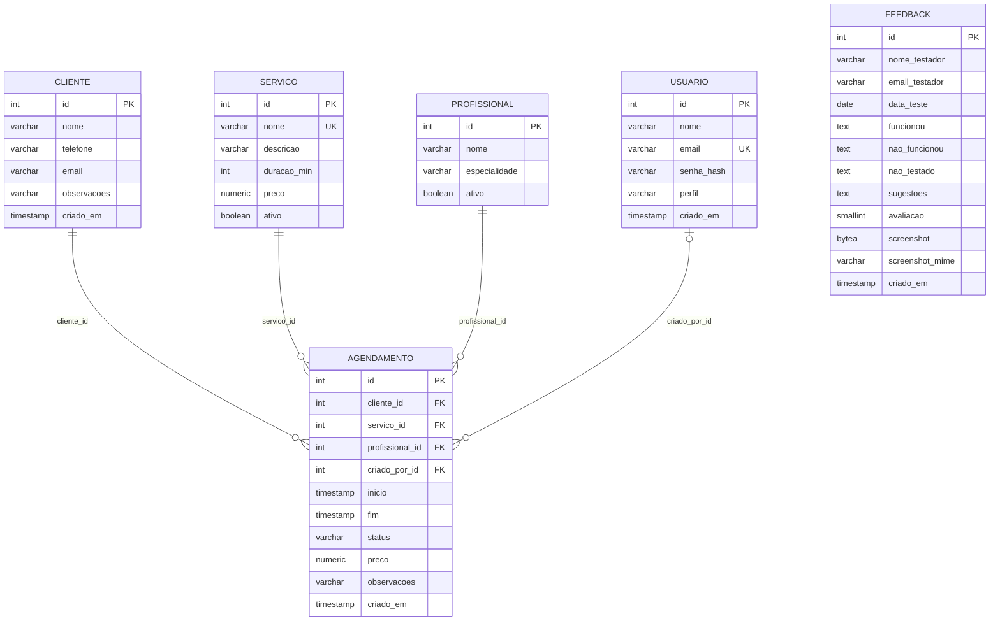

# 5. Projeto de dados

O projeto de dados parte do diagrama de classes de persistência ([03-modelagem-uml.md](03-modelagem-uml.md)), como pede a Situação-Problema 1, e passa pelos três níveis: conceitual, lógico normalizado e físico.

- **SGBD**: PostgreSQL 16+ (Neon, gerenciado). Popular, gratuito, de fácil manutenção e com suporte nativo no Vercel.
- **Acesso**: SQLAlchemy (ORM). O mesmo código roda em PostgreSQL (produção) e SQLite (testes automatizados).

## 5.1 Modelo conceitual (entidade-relacionamento)

A entidade **FEEDBACK** (laudos dos testadores) é independente e não aparece no diagrama.

| Relacionamento | Cardinalidade | Leitura |
|---|---|---|
| Cliente – Agendamento | 1 : N | Um cliente pode ter vários agendamentos; cada agendamento é de exatamente um cliente. |
| Serviço – Agendamento | 1 : N | Cada agendamento é de um serviço (um atendimento com dois serviços vira dois agendamentos). |
| Profissional – Agendamento | 1 : N | Cada agendamento é executado por um profissional. |
| Usuário – Agendamento | 0..1 : N | Registra quem criou. Opcional: se o usuário for removido, o agendamento continua (`SET NULL`). |
| Feedback | independente | Laudos dos testadores; não se relaciona com o negócio. |

## 5.2 Modelo lógico normalizado

### Verificação das formas normais

- **1FN**: todos os atributos são atômicos. Telefone é um valor só (guardado só com dígitos); não há listas como "serviços" dentro de um agendamento: cada agendamento tem um serviço.
- **2FN**: todas as chaves primárias são simples (`id`), então não existe dependência parcial.
- **3FN**: nenhum atributo não-chave depende de outro atributo não-chave. Os dados do cliente, do serviço e do profissional estão nas tabelas deles; o agendamento guarda só as chaves estrangeiras.

**Decisões conscientes de modelagem (não violam a 3FN):**

| Atributo | Por que existe |
|---|---|
| `agendamento.preco` | Não é cópia redundante de `servico.preco`. É o **preço praticado naquele atendimento**, um fato histórico. Se o serviço for reajustado, os atendimentos antigos precisam continuar com o valor cobrado na época (RN07). |
| `agendamento.fim` | Poderia ser calculado (`inicio + duracao`), mas a duração do serviço pode mudar depois. Gravar `fim` preserva o intervalo realmente reservado e permite verificar conflitos com uma única consulta indexada (`inicio < :fim AND fim > :inicio`). |

## 5.3 Projeto físico

O script DDL completo está em **[schema.sql](schema.sql)**. Ele é gerado por `python scripts/gerar_schema.py` a partir dos próprios Models, para que o documento nunca fique diferente do banco real. A aplicação cria as tabelas automaticamente na primeira execução (`db.create_all()`).

Restrições de integridade garantidas **pelo banco** (além da validação na aplicação):

| Tabela | Restrição | Tipo |
|---|---|---|
| usuario | `email` único (`ix_usuario_email`) | UNIQUE |
| usuario | `perfil IN ('admin','atendente')` | CHECK |
| servico | `nome` único | UNIQUE |
| servico | `duracao_min BETWEEN 5 AND 480`, `preco >= 0` | CHECK |
| agendamento | `fim > inicio`, `preco >= 0`, `status IN ('agendado','concluido','cancelado')` | CHECK |
| agendamento | `cliente_id`, `servico_id`, `profissional_id` → `ON DELETE RESTRICT` | FOREIGN KEY |
| agendamento | `criado_por_id` → `ON DELETE SET NULL` | FOREIGN KEY |
| feedback | `avaliacao` nula ou entre 1 e 5 | CHECK |

Índices para as consultas mais frequentes:

| Índice | Consulta atendida |
|---|---|
| `ix_agendamento_profissional_inicio (profissional_id, inicio)` | Conflito de horário do profissional; agenda filtrada por profissional; disponibilidade |
| `ix_agendamento_cliente_inicio (cliente_id, inicio)` | Conflito do cliente; histórico na ficha do cliente |
| `ix_cliente_nome (nome)` | Lista de clientes ordenada por nome |
| `ix_usuario_email (email)` | Login |

## 5.4 Dicionário de dados

Legenda: **PK** chave primária · **FK** chave estrangeira · **UK** único · **NN** obrigatório (NOT NULL).

### usuario: pessoas que operam o sistema
| Coluna | Tipo | Restrições | Domínio / descrição |
|---|---|---|---|
| id | SERIAL | PK | Identificador gerado pelo banco |
| nome | VARCHAR(100) | NN | 2 a 100 caracteres |
| email | VARCHAR(120) | NN, UK | E-mail válido, gravado em minúsculas; usado no login |
| senha_hash | VARCHAR(255) | NN | *Hash* da senha (PBKDF2/scrypt, Werkzeug). A senha nunca é gravada. Senha com mínimo de 6 caracteres. |
| perfil | VARCHAR(20) | NN, CHECK, padrão `'atendente'` | `admin` ou `atendente`. A 1ª conta é `admin`. |
| criado_em | TIMESTAMP | NN | Data/hora de criação (fuso America/Sao_Paulo) |

### cliente: pessoas atendidas
| Coluna | Tipo | Restrições | Domínio / descrição |
|---|---|---|---|
| id | SERIAL | PK | |
| nome | VARCHAR(100) | NN, índice | 2 a 100 caracteres |
| telefone | VARCHAR(11) | NN | Somente dígitos, DDD + número: 10 (fixo) ou 11 (celular) dígitos. Exibido como (11) 98765-4321. |
| email | VARCHAR(120) | | Opcional; e-mail válido, minúsculas |
| observacoes | VARCHAR(500) | | Opcional; preferências, alergias etc. |
| criado_em | TIMESTAMP | NN | Data de cadastro ("Cliente desde") |

### servico: serviços oferecidos
| Coluna | Tipo | Restrições | Domínio / descrição |
|---|---|---|---|
| id | SERIAL | PK | |
| nome | VARCHAR(80) | NN, UK | 2 a 80 caracteres; único sem diferenciar maiúsculas (validado na aplicação) |
| descricao | VARCHAR(255) | | Opcional |
| duracao_min | INTEGER | NN, CHECK | Minutos, de 5 a 480 (8 h) |
| preco | NUMERIC(10,2) | NN, CHECK | Reais, de 0,00 a 99.999,99 |
| ativo | BOOLEAN | NN, padrão `true` | `false` = não aparece em novos agendamentos |

### profissional: quem executa os serviços
| Coluna | Tipo | Restrições | Domínio / descrição |
|---|---|---|---|
| id | SERIAL | PK | |
| nome | VARCHAR(100) | NN | 2 a 100 caracteres |
| especialidade | VARCHAR(80) | | Opcional (ex.: Cabeleireira) |
| ativo | BOOLEAN | NN, padrão `true` | `false` = não aparece em novos agendamentos |

### agendamento: reserva de horário
| Coluna | Tipo | Restrições | Domínio / descrição |
|---|---|---|---|
| id | SERIAL | PK | |
| cliente_id | INTEGER | NN, FK → cliente.id (RESTRICT) | |
| servico_id | INTEGER | NN, FK → servico.id (RESTRICT) | |
| profissional_id | INTEGER | NN, FK → profissional.id (RESTRICT) | |
| criado_por_id | INTEGER | FK → usuario.id (SET NULL) | Quem criou o agendamento |
| inicio | TIMESTAMP | NN | Seg–sáb, ≥ 08:00, não pode estar no passado no momento da criação |
| fim | TIMESTAMP | NN, CHECK `fim > inicio` | `inicio + servico.duracao_min`; ≤ 20:00 |
| status | VARCHAR(20) | NN, CHECK, padrão `'agendado'` | `agendado`, `concluido` ou `cancelado` (ver diagrama de estados) |
| preco | NUMERIC(10,2) | NN, CHECK ≥ 0 | Preço praticado, copiado do serviço no momento do agendamento |
| observacoes | VARCHAR(500) | | Opcional |
| criado_em | TIMESTAMP | NN | |

### feedback: laudos dos testadores (Situação 3)
| Coluna | Tipo | Restrições | Domínio / descrição |
|---|---|---|---|
| id | SERIAL | PK | |
| nome_testador | VARCHAR(100) | NN | 2 a 100 caracteres |
| email_testador | VARCHAR(120) | | Opcional |
| data_teste | DATE | NN | Não pode ser futura |
| funcionou | TEXT | | O que testou e funcionou (até 5000 caracteres) |
| nao_funcionou | TEXT | | O que testou e não funcionou / o que corrigir |
| nao_testado | TEXT | | Funcionalidade não testada e motivo |
| sugestoes | TEXT | | Sugestões de melhoria |
| avaliacao | SMALLINT | CHECK | 1 (muito difícil) a 5 (muito fácil); opcional |
| screenshot | BYTEA | | Captura de tela de até 2 MB (PNG, JPG, GIF ou WEBP, verificado pela assinatura do arquivo) |
| screenshot_mime | VARCHAR(30) | | Tipo da imagem (ex.: image/png) |
| criado_em | TIMESTAMP | NN | Data/hora do envio |

Pelo menos um entre `funcionou`, `nao_funcionou`, `nao_testado` e `sugestoes` precisa ser preenchido (regra da aplicação).
