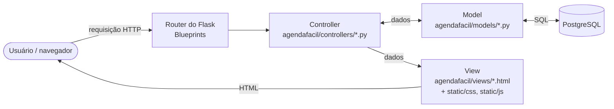

# 1. Arquitetura da solução (MVC)

## 1.1 Visão geral

| Item | Escolha | Motivo |
|---|---|---|
| Linguagem do back-end | **Python 3.12** | Linguagem sugerida pela disciplina; sintaxe clara e ecossistema maduro para web. |
| Framework web | **Flask 3** | Leve; deixa explícita a separação Model/View/Controller (Blueprints + Jinja2 + SQLAlchemy). |
| ORM | **SQLAlchemy 2 / Flask-SQLAlchemy** | Mapeia as classes do diagrama para tabelas; o mesmo código roda em PostgreSQL e SQLite. |
| Banco de dados | **PostgreSQL (Neon)** | SGBD popular e robusto; o Neon tem plano gratuito, sem prazo de expiração. |
| Front-end | **HTML5 + CSS3 + JavaScript puro** | Sem *framework* e sem etapa de *build*; renderizado no servidor por templates Jinja2. |
| Hospedagem | **Render** (Web Service Python + gunicorn) | Plano gratuito, deploy automático a cada `git push`, HTTPS e domínio gratuitos. Compatível também com Vercel (`vercel.json`). |
| Testes | **pytest** + **pytest-cov** + **Playwright** | Unidade, integração e ponta a ponta em navegador real. |
| Modo de codificação | **Tradicional** | Todo o código foi escrito à mão, sem *low-code* ou *no-code*. |

## 1.2 Padrão MVC aplicado



O diagrama reproduz a Figura 2 do material teórico (Usuário → Router → Controller ↔ Model; Controller → View → HTML).

| Camada | Pasta | Responsabilidade | Exemplo |
|---|---|---|---|
| **Model** | `agendafacil/models/` | Entidades, persistência e **regras de negócio** e validação. É o centro da aplicação. | `Agendamento.definir()` calcula o término e valida conflitos; `alterar_status()` aplica a máquina de estados. |
| **View** | `agendafacil/views/` e `agendafacil/static/` | Apresentação: templates HTML (Jinja2), estilos e comportamentos no navegador. Não acessa o banco. | `agendamentos/form.html`, `static/js/agendamento.js` |
| **Controller** | `agendafacil/controllers/` | Recebe a requisição, chama o Model, decide qual View mostrar ou para onde redirecionar. | `agendamentos.novo()`: lê o formulário, chama `definir()`, faz *commit* ou mostra os erros. |

Arquivos de apoio: `config.py` (configuração e regras ajustáveis), `extensions.py` (instância do banco), `utils.py` (datas, formatação, CSRF, login obrigatório), `seed.py` (dados de exemplo), `__init__.py` (fábrica da aplicação: registra Blueprints, filtros e tratamento de erros).

## 1.3 Estrutura de pastas

```
projeto_faculdade/
├── agendafacil/                 # aplicação (pacote Python)
│   ├── __init__.py              # create_app(): fábrica da aplicação
│   ├── config.py                # variáveis de ambiente e regras configuráveis
│   ├── extensions.py            # db = SQLAlchemy()
│   ├── utils.py                 # utilitários, CSRF, login_obrigatorio
│   ├── seed.py                  # dados de demonstração
│   ├── models/                  # M: usuario, cliente, servico, profissional, agendamento, feedback
│   ├── controllers/             # C: auth, dashboard, clientes, servicos, profissionais, agendamentos, feedback
│   ├── views/                   # V: templates Jinja2
│   └── static/                  # V: css/, js/, img/
├── wsgi.py                      # ponto de entrada WSGI (gunicorn, no Render)
├── api/index.py                 # ponto de entrada alternativo (função serverless do Vercel)
├── tests/                       # pytest: unidade, integração e e2e/
├── scripts/gerar_schema.py      # gera docs/situacao-1/schema.sql a partir dos Models
├── docs/                        # documentação organizada por Situação-Problema
├── vercel.json                  # configuração do Vercel (alternativa)
├── requirements.txt             # dependências de produção
└── requirements-dev.txt         # + dependências de teste
```

## 1.4 Rotas (Controllers)

| Método | Rota | Controller | Acesso |
|---|---|---|---|
| GET/POST | `/login`, `/cadastro` | auth | público |
| POST | `/logout` | auth | logado |
| GET | `/` | dashboard.inicio | logado |
| POST | `/dados-exemplo` | dashboard.dados_exemplo | admin |
| GET | `/saude` | dashboard.saude | público (JSON) |
| GET | `/clientes/`, `/clientes/<id>` | clientes.lista / detalhe | logado |
| GET/POST | `/clientes/novo`, `/clientes/<id>/editar` | clientes | logado |
| POST | `/clientes/<id>/excluir` | clientes.excluir | logado |
| GET/POST | `/servicos/…`, `/profissionais/…` | servicos, profissionais (lista, novo, editar, alternar, excluir) | logado |
| GET | `/agendamentos/` | agendamentos.lista (filtros `data`, `status`, `profissional_id`, `periodo`) | logado |
| GET/POST | `/agendamentos/novo`, `/agendamentos/<id>/editar` | agendamentos | logado |
| POST | `/agendamentos/<id>/status` | agendamentos.alterar_status | logado |
| GET | `/agendamentos/disponibilidade` | agendamentos.disponibilidade (JSON: horários livres ou bloqueados com motivo e ocupação; parâmetros `data`, `profissional_id`, `servico_id`, `cliente_id`, `ignorar`) | logado |
| GET/POST | `/feedback/` | feedback.formulario | público |
| GET | `/feedback/recebidos`, `/feedback/<id>/screenshot`, `/feedback/exportar.csv` | feedback | admin |
| POST | `/feedback/<id>/excluir` | feedback.excluir | admin |

## 1.5 Tratamento de erros

- **Validação em duas camadas**: o navegador valida o preenchimento para dar resposta imediata, e o Model valida de novo todas as regras, porque o navegador pode ser contornado.
- **Erros de validação** não geram exceção: os métodos `preencher()` e `definir()` devolvem uma **lista de mensagens**. O Controller mostra as mensagens, faz *rollback* e devolve o formulário com os dados digitados.
- **Sem gravação parcial**: as consultas de validação rodam com `no_autoflush`, para que um dado inválido nunca seja enviado ao banco antes de ser aprovado.
- **Erros HTTP** (400, 403, 404, 405, 413) e **exceções inesperadas** (500) mostram a página amigável `views/erros/erro.html`. Exceções são registradas no log (`app.logger.exception`) e a transação é desfeita.
- **Banco como última barreira**: `CHECK`, `UNIQUE`, `NOT NULL` e `FOREIGN KEY` garantem a integridade mesmo se houver falha na aplicação.

## 1.6 Segurança

| Ameaça | Proteção |
|---|---|
| Vazamento de senhas | Somente o *hash* é gravado (`werkzeug.security`) |
| CSRF (requisição forjada) | Token por sessão exigido em todo POST (`utils.verificar_csrf`) |
| Roubo de sessão | Cookie assinado, `HttpOnly`, `SameSite=Lax` e `Secure` em produção |
| Open redirect | `destino_seguro()` aceita apenas caminhos internos |
| Clickjacking / MIME sniffing | `X-Frame-Options: DENY`, `X-Content-Type-Options: nosniff` |
| XSS | Jinja2 escapa todo conteúdo por padrão; o JavaScript usa `textContent` |
| SQL injection | Todas as consultas passam pelo SQLAlchemy (parâmetros vinculados) |
| Upload malicioso | Tipo verificado pela assinatura binária (não pela extensão), limite de 2 MB |
| Enumeração de usuários | Login responde "E-mail ou senha incorretos" sem dizer qual |
| Contas indevidas | `CADASTRO_ABERTO=0` fecha o cadastro após o período de testes |
| Segredos no código | `SECRET_KEY` e `DATABASE_URL` só em variáveis de ambiente; a aplicação recusa iniciar em produção (Render/Vercel) sem elas |
