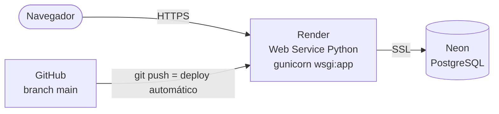

# 3. Instalação local e publicação (Render + Neon)

## 3.1 Rodar no computador (desenvolvimento)

Pré-requisitos: Python 3.12 ou superior e Git.

```bash
git clone https://github.com/Lex-Stki/projeto_faculdade.git
cd projeto_faculdade
python -m venv .venv
# Windows (PowerShell/CMD):
.venv\Scripts\activate
# Git Bash:
source .venv/Scripts/activate
# Linux/macOS:
source .venv/bin/activate

pip install -r requirements-dev.txt
flask --app agendafacil run --debug
```

Abra http://127.0.0.1:5000. Sem `DATABASE_URL`, o sistema usa SQLite em `instance/agendafacil.db`. Para testar com PostgreSQL localmente, crie um arquivo `.env` a partir de `.env.example` ou exporte as variáveis.

Comandos úteis:

| Comando | O que faz |
|---|---|
| `flask --app agendafacil seed` | Cria dados de demonstração |
| `pytest` | Roda todos os testes (unidade, integração e E2E) |
| `pytest --cov=agendafacil --cov-report=term-missing` | Testes com relatório de cobertura |
| `pytest tests/e2e` | Só os testes no navegador (precisa de Edge/Chrome e `pip install playwright`) |
| `E2E_EVIDENCIAS=1 pytest tests/e2e` | Gera as capturas em `docs/situacao-3/evidencias/` |
| `python scripts/gerar_schema.py` | Regenera `docs/situacao-1/schema.sql` |

## 3.2 Arquitetura de implantação



| Peça | Serviço | Plano |
|---|---|---|
| Aplicação Flask | **Render** (Web Service, runtime Python, servidor `gunicorn`) | Free |
| Banco de dados | **Neon** (PostgreSQL gerenciado) | Free |
| Código-fonte | GitHub | Público |

Limitação do plano gratuito do Render: depois de 15 minutos sem acesso, o serviço "dorme", e a primeira visita seguinte leva cerca de 50 segundos para abrir. As visitas seguintes são normais.

## 3.3 Passo 1: Criar o banco no Neon

1. Acesse https://neon.tech → **Sign up** (pode entrar com a conta do GitHub).
2. Crie o projeto:
   - **Project name:** `agendafacil`
   - **Postgres version:** a sugerida (17)
   - **Region:** **AWS US East 1 (N. Virginia)**, a mesma região que será usada no Render
   - **Create project**
3. No painel do projeto, clique em **Connect**, copie a **connection string** (começa com `postgresql://`) e guarde-a. Ela será a `DATABASE_URL`.

## 3.4 Passo 2: Criar o serviço no Render

1. Acesse https://render.com → **Get Started** → entre com o **GitHub** (conta dona do repositório).
2. **New + → Web Service** → **Git Provider: GitHub** → autorize e escolha o repositório `projeto_faculdade` → **Connect**.
3. Preencha:

| Campo | Valor |
|---|---|
| Name | `agendafacil` (vira `https://agendafacil.onrender.com`, ou com um sufixo se o nome estiver em uso) |
| Region | **Virginia (US East)** |
| Branch | `main` |
| Root Directory | (vazio) |
| Runtime / Language | **Python 3** |
| Build Command | `pip install -r requirements.txt` |
| Start Command | `gunicorn wsgi:app --workers 2 --timeout 60` |
| Instance Type | **Free** |

4. Em **Environment Variables** (*Add Environment Variable*), crie:

| Key | Value |
|---|---|
| `SECRET_KEY` | valor aleatório longo (gerar com `python -c "import secrets; print(secrets.token_hex(32))"`) |
| `DATABASE_URL` | a connection string do Neon |
| `PYTHON_VERSION` | `3.12.11` |

5. (Opcional) Em **Advanced → Health Check Path**, coloque `/saude`.
6. Clique em **Deploy Web Service**. Acompanhe os **Logs** até aparecer `Your service is live`.

## 3.5 Passo 3: Testar

1. Abra `https://SEU-SERVICO.onrender.com/saude`. Deve aparecer `{"banco":"ok","status":"ok"}`.
2. Abra a página inicial, **crie a conta de administrador** (a primeira conta) e, se quiser, carregue os dados de exemplo.

As tabelas são criadas automaticamente na primeira inicialização. Se preferir criá-las à mão, rode [`docs/situacao-1/schema.sql`](../situacao-1/schema.sql) no **SQL Editor** do Neon ou no DBeaver.

A cada `git push` na branch `main`, o Render publica a nova versão automaticamente.

## 3.6 Passo 4: Depois do período de testes

Quando os 5 colegas terminarem de testar, adicione `CADASTRO_ABERTO` = `0` em **Environment** no Render e salve. O Render reinicia o serviço sozinho. A partir daí ninguém mais consegue criar conta pelo site.

## 3.7 Variáveis de ambiente

| Variável | Obrigatória em produção | Descrição |
|---|---|---|
| `SECRET_KEY` | Sim | Assina o cookie de sessão. Sem ela, a aplicação não inicia. |
| `DATABASE_URL` (ou `POSTGRES_URL`) | Sim | URL do PostgreSQL (Neon). |
| `PYTHON_VERSION` | Recomendada (Render) | Versão do Python usada no build. |
| `CADASTRO_ABERTO` | Não | `1` (padrão) permite criar contas; `0` fecha o cadastro. |

O sistema detecta que está em produção pelas variáveis `RENDER` ou `VERCEL`, que as próprias plataformas definem. Em produção, exige `SECRET_KEY` e `DATABASE_URL`, usa cookie `Secure` e confia nos cabeçalhos `X-Forwarded-*` do proxy HTTPS.

## 3.8 Ver o banco no DBeaver

1. Neon → projeto → **Connect**: anote host, database, user e password (desmarque *Connection pooling* para usar o host direto).
2. DBeaver → **Banco de dados → Nova conexão → PostgreSQL**: Host, Port `5432`, Database, Username, Password.
3. Aba **SSL**: marque **Use SSL**, **SSL mode = require**.
4. **Testar conexão → Concluir**. As tabelas ficam em `Schemas → public → Tables`. Para ver o diagrama: botão direito em `public` → **Visualizar diagrama**.

## 3.9 Problemas comuns

| Sintoma | Causa / solução |
|---|---|
| Build falha em `pip install` | Confira se `PYTHON_VERSION` = `3.12.11` e se o Build Command está exatamente como na tabela. |
| Logs mostram `SECRET_KEY não configurada` ou `DATABASE_URL não configurada` | Falta a variável em **Environment**. Crie e salve; o Render reinicia sozinho. |
| `/saude` responde `503` | A aplicação está no ar, mas não conecta ao banco. Confira a `DATABASE_URL` (ela deve conter `sslmode=require`). |
| Primeira abertura demora cerca de 50 s | O serviço gratuito estava dormindo. É normal. |
| Usuários "deslogados" sozinhos | `SECRET_KEY` foi alterada. Mantenha um valor fixo. |

## 3.10 Alternativa: Vercel

O projeto também funciona no Vercel (arquivos `vercel.json` e `api/index.py`): importe o repositório com **Framework Preset = Other**, crie `SECRET_KEY`, conecte um banco Neon em **Storage** e faça **Redeploy**. Neste projeto o Render foi adotado porque a conta do Vercel ficou retida na verificação de segurança da plataforma.
