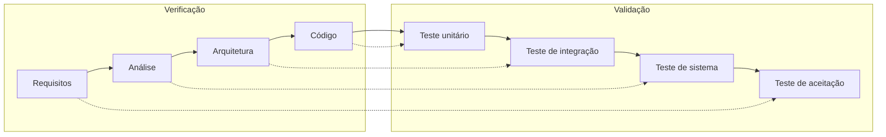

# 4. Testes automatizados

A disciplina pede "front-end e back-end testados (por exemplo, JUnit, PUnit, PHPUnit etc.)". Como o projeto é em Python, a ferramenta é o **pytest**, indicado no material. O front-end é testado em navegador real com **Playwright**.

## 4.1 Estratégia: Modelo V



| Nível do Modelo V | O que valida | Onde | Qtde. |
|---|---|---|---|
| **Unitário** | Cada regra de negócio do Model isolada: cálculo de término, conflitos, horário, transições de status, validações de cliente, serviço, usuário e laudo; utilitários de formatação e segurança | `tests/test_models.py`, `tests/test_utils.py` | 83 |
| **Integração** | Requisição HTTP → Controller → Model → banco → View: login, CSRF, CRUDs, filtros, paginação, JSON de disponibilidade, upload, permissões, páginas de erro | `tests/test_controllers.py` | 40 |
| **Sistema (E2E)** | Servidor real + navegador real (Edge/Chrome): máscara de telefone, validação no navegador, término previsto, painel de disponibilidade, diálogo de confirmação, layout no celular, ausência de erros de JavaScript | `tests/e2e/test_fluxos.py` | 2 cenários (23 verificações) |
| **Aceitação** | Uso real por 5 colegas, registrado pelo formulário de laudo | Situação 3: [plano de testes](../situacao-3/01-plano-de-testes.md) | 5 testadores |

## 4.2 Como rodar

```bash
pip install -r requirements-dev.txt
pip install playwright          # opcional, para os testes E2E
pytest --cov=agendafacil --cov-report=term-missing
```

Sem Playwright ou sem navegador, os testes E2E são ignorados automaticamente (*skip*) e os demais rodam normalmente.

Por padrão os testes usam **SQLite em memória**: são rápidos e não sujam nenhum banco. Para rodá-los contra **PostgreSQL** (por exemplo, um *branch* de teste no Neon), defina `TEST_DATABASE_URL`. Atenção: os testes apagam as tabelas desse banco ao final.

## 4.3 Resultado da última execução

```
$ pytest --cov=agendafacil --cov-report=term
Name                                       Stmts   Miss  Cover
--------------------------------------------------------------
agendafacil\__init__.py                       68      6    91%
agendafacil\config.py                         41      5    88%
agendafacil\controllers\agendamentos.py       98      3    97%
agendafacil\controllers\auth.py               53      2    96%
agendafacil\controllers\clientes.py           77      3    96%
agendafacil\controllers\dashboard.py          30      0   100%
agendafacil\controllers\feedback.py           58      2    97%
agendafacil\controllers\profissionais.py      67     14    79%
agendafacil\controllers\servicos.py           69     12    83%
agendafacil\models\agendamento.py            119      4    97%
agendafacil\models\cliente.py                 28      2    93%
agendafacil\models\feedback.py                62      3    95%
agendafacil\models\profissional.py            19      3    84%
agendafacil\models\servico.py                 40      3    92%
agendafacil\models\usuario.py                 33      1    97%
agendafacil\seed.py                           22      0   100%
agendafacil\utils.py                          82      0   100%
--------------------------------------------------------------
TOTAL                                        975     63    94%
125 passed
```

As linhas não cobertas são, na maior parte, caminhos de erro repetidos entre controllers parecidos (ex.: "profissional não encontrado → 404", já testado para clientes) e os ramos que só rodam em produção no Render/Vercel (falta de variáveis de ambiente, testados à parte em `test_utils.py`).

## 4.4 Exemplos

Regra de negócio isolada (unitário):

```python
def test_conflito_mesmo_profissional(self, db, base):
    criar_agendamento(db, base, datetime(2030, 1, 7, 10, 0))
    erros = Agendamento().definir(form_agendamento(base, hora="10:30", cliente="outro_cliente"),
                                  referencia=REFERENCIA)
    assert any("Ana Souza já tem atendimento das 10:00 às 11:00" in e for e in erros)
```

Fluxo HTTP completo (integração):

```python
def test_remarcacao_invalida_nao_altera_o_banco(self, logado, base, db):
    a = criar_agendamento(db, base, datetime(2030, 1, 7, 10, 0))
    post(logado, f"/agendamentos/{a.id}/editar", form_agendamento(base, hora="21:00"))
    db.session.expire_all()
    assert db.session.get(Agendamento, a.id).inicio == datetime(2030, 1, 7, 10, 0)
```

Comportamento no navegador (E2E):

```python
page.locator("#telefone").press_sequentially("11987654321")
assert page.input_value("#telefone") == "(11) 98765-4321"
```
