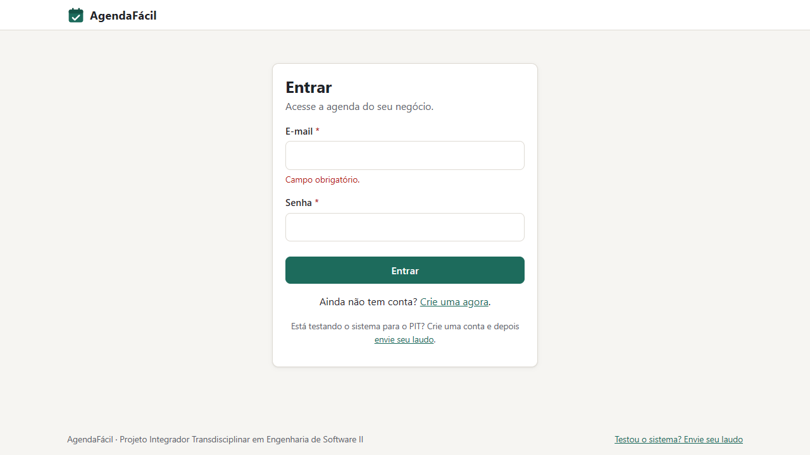
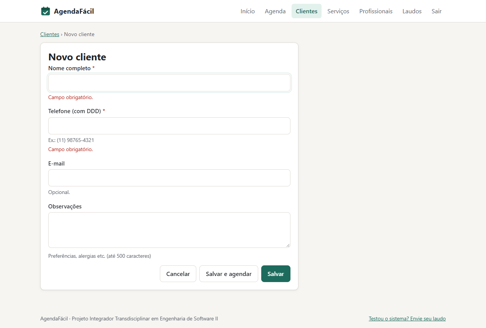

# 3. Laudo de qualidade

| Item | Valor |
|---|---|
| Sistema | AgendaFácil: agendamento para negócios de serviços |
| Versão avaliada | 2.2 (branch `main`) |
| Ambiente de verificação | Windows 11, Python 3.13, SQLite em memória (testes), Microsoft Edge (E2E) |
| Ambiente de produção | Render (Python 3.12, gunicorn) + PostgreSQL (Neon) |
| Data da verificação interna | 17/11/2026 |

## 3.1 Resumo

| Indicador | Resultado |
|---|---|
| Testes automatizados | **125 aprovados / 0 falhas** (83 unidade, 40 integração, 2 cenários E2E) |
| Cobertura de código | **94 %** |
| Defeitos encontrados na verificação interna e no deploy | 6 (2 altas, 2 médias, 2 baixas) |
| Defeitos corrigidos | 6 de 6, cada um com teste de regressão |
| Erros de JavaScript no navegador durante o E2E | 0 |
| Testes de aceitação (colegas) | **Pendente**: ver seção 3.4 |

## 3.2 Defeitos encontrados na verificação interna e correções

### D1: Clique em link ou botão "não funciona" logo depois de sair de um campo (média)

| | |
|---|---|
| **Como foi encontrado** | Teste E2E `test_fluxo_completo`, passo 1: o clique em "Crie uma agora" na tela de login não abria o cadastro (Timeout esperando o campo `#nome`). |
| **Evidência** | Captura do momento da falha (abaixo, à esquerda): a mensagem "Campo obrigatório." apareceu sob o e-mail sem que o usuário tivesse enviado nada, e a página continuou no login. |
| **Causa** | O campo e-mail tem foco automático. O JavaScript validava cada campo ao **perder o foco** (*blur*). Ao clicar no link, o *blur* inseria a mensagem de erro, a página descia cerca de 20 px e o fim do clique caía fora do link. O mesmo acontecia ao contrário: corrigir um campo e clicar em "Salvar" removia a mensagem, a página subia e o clique errava o botão. |
| **Correção** | Nova estratégia de validação (`static/js/app.js`): os erros aparecem **no envio** e somem **enquanto a pessoa digita** no campo com erro. Nada muda de lugar no momento do clique. |
| **Teste de regressão** | `test_fluxo_completo` (passos 1 e 3) |
| **Status** | Corrigido |

| Antes da correção | Depois da correção |
|---|---|
|  |  |

### D2: Mensagens de sucesso sumiam sozinhas e deslocavam a página (baixa)

| | |
|---|---|
| **Como foi encontrado** | Análise da causa do D1: o alerta de sucesso era removido após 6 s, o que também desloca todo o conteúdo para cima, possivelmente durante um clique. |
| **Correção** | As mensagens só são fechadas pelo usuário (botão ×), seguindo o princípio "controlada pelo usuário". |
| **Status** | Corrigido |

### D3: E-mail longo no laudo de teste causaria erro 500 só em produção (média)

| | |
|---|---|
| **Como foi encontrado** | Revisão das diferenças entre SQLite (testes) e PostgreSQL (produção). O PostgreSQL rejeita textos maiores que o `VARCHAR`; o SQLite aceita. Todos os campos tinham verificação de tamanho, exceto `feedback.email_testador` (120). |
| **Impacto** | Um testador com e-mail de mais de 120 caracteres veria "Erro interno" em produção, e o problema não apareceria nos testes locais. |
| **Correção** | Validação de tamanho em `Feedback.preencher()`. |
| **Teste de regressão** | `TestFeedback::test_email_longo_demais` |
| **Status** | Corrigido |

### D4: Renomear um serviço para um nome já existente gerava erro 500 (alta)

| | |
|---|---|
| **Como foi encontrado** | Revisão de código (verificação) do fluxo de edição, antes da primeira execução. |
| **Causa** | O SQLAlchemy grava automaticamente as alterações pendentes antes de cada consulta (*autoflush*). Ao validar "nome já existe?", a alteração inválida era enviada ao banco, a restrição `UNIQUE` disparava e o resultado era um erro 500 em vez da mensagem amigável. No caso da remarcação, uma alteração ainda não validada podia ser enviada ao banco durante a checagem de conflitos. |
| **Correção** | Consultas de validação dentro de `db.session.no_autoflush`; `rollback()` explícito quando há erro; formulários renderizados a partir dos dados digitados, não do objeto do banco. |
| **Testes de regressão** | `test_renomear_para_nome_existente_nao_quebra`, `test_edicao_invalida_nao_altera_o_banco`, `test_remarcacao_invalida_nao_altera_o_banco` |
| **Status** | Corrigido |

### D5: Endereço de retorno após o login terminava com "?" (baixa)

| | |
|---|---|
| **Como foi encontrado** | Teste exploratório (*smoke test*): acessar `/` sem login redirecionava para `/login?proximo=/?`. |
| **Correção** | Remoção do `?` final em `login_obrigatorio`. |
| **Status** | Corrigido |

### D6: Deploy no Render falhava com `ModuleNotFoundError: No module named 'psycopg'` (alta)

| | |
|---|---|
| **Como foi encontrado** | Primeiro deploy no Render (validação em ambiente real). A aplicação não iniciava. |
| **Causa** | A partir do **SQLAlchemy 2.1** (versão usada no projeto), um endereço `postgresql://` sem driver explícito passa a usar o *psycopg 3*, mas o projeto instala o *psycopg2*. Os testes não pegaram o problema porque rodam em SQLite e só comparavam o texto da URL, sem verificar qual driver seria carregado. |
| **Primeira tentativa (incorreta)** | A primeira hipótese foi que o painel do Neon gerava a URL no formato `postgresql+psycopg://`. A normalização feita para isso não resolveu: o segundo deploy falhou com o mesmo erro, o que mostrou que a causa era outra. Fica registrado como aprendizado: a correção precisa ser validada no ambiente onde o erro aconteceu. |
| **Correção** | `config.normalizar_url_postgres()` converte qualquer variação (`postgres://`, `postgresql://`, `postgresql+psycopg://`, `postgresql+asyncpg://`, com aspas ou espaços colados) para **`postgresql+psycopg2://`**, deixando o driver explícito. |
| **Testes de regressão** | `test_url_postgres_e_normalizada` (6 variações), `test_driver_postgres_carregado_esta_instalado` (verifica que o driver escolhido pelo SQLAlchemy é o psycopg2 e que ele importa), `test_url_de_outro_banco_nao_e_alterada` |
| **Status** | Corrigido |

Na primeira execução da suíte houve também uma falha em `test_desativar_e_reativar_servico` que **era erro do próprio teste**: ele procurava a palavra "Corte" na página, mas ela aparecia na mensagem "Serviço “Corte” desativado". O teste foi ajustado para procurar o texto da opção do formulário. Não houve mudança no sistema.

## 3.3 Limitações conhecidas (riscos aceitos nesta versão)

| # | Limitação | Risco | Tratamento |
|---|---|---|---|
| L1 | Duas pessoas salvando agendamentos conflitantes **no mesmo segundo** poderiam passar ambas pela verificação | Baixo para um pequeno negócio (1–2 atendentes) | Evolução: restrição de exclusão no PostgreSQL (`EXCLUDE USING gist`) |
| L2 | O formato dos campos de data e hora (ex.: 01/07/2030 × 07/01/2030, AM/PM) segue o idioma do **navegador**, não do site | Confusão em navegadores configurados em inglês | Documentado; os textos do sistema usam sempre dd/mm/aaaa |
| L3 | Não há recuperação de senha por e-mail | Usuário bloqueado se esquecer a senha | Fora do escopo (próxima versão) |
| L4 | Cadastro aberto: qualquer pessoa com o link pode criar conta e ver os dados | Exposição de dados de clientes | Necessário durante os testes; depois, `CADASTRO_ABERTO=0` |
| L5 | A suíte automatizada roda em SQLite; em PostgreSQL só foi verificada por revisão | Diferença de comportamento entre bancos | Rodar `TEST_DATABASE_URL=<branch de teste do Neon> pytest` após criar o banco e conferir `/saude` em produção |

## 3.4 Resultados dos testes de aceitação (colegas)

*Preencher após receber os laudos (menu **Laudos** → Exportar CSV).*

| # | Testador | Data | Problemas relatados | Severidade | Ação tomada | Status |
|---|---|---|---|---|---|---|
| 1 | | | | | | |
| 2 | | | | | | |
| 3 | | | | | | |
| 4 | | | | | | |
| 5 | | | | | | |

**Sugestões recebidas e decisão:**

| Sugestão | Aceita? | Justificativa |
|---|---|---|
| | | |

**Nota média de facilidade de uso:** ___ / 5

## 3.5 Evidências

Todas as capturas em [`evidencias/`](evidencias/) foram geradas automaticamente pelo teste E2E (`E2E_EVIDENCIAS=1 pytest tests/e2e`), sempre a partir da versão atual do código.

| Arquivo | O que comprova |
|---|---|
| `01-login.png` | Tela de entrada |
| `02-primeiros-passos.png` | Primeira conta = admin; orientação inicial |
| `03-validacao-formulario.png` | Validação no navegador após a correção do D1 |
| `04-formulario-agendamento.png` | Término previsto e disponibilidade em tempo real (RN06, RF08) |
| `05-agenda-do-dia.png` | Agendamento criado e mensagem de sucesso |
| `06-conflito-de-horario.png` | Bloqueio de conflito com mensagem explicativa (RN03) |
| `07-dialogo-confirmacao.png` | Confirmação antes de cancelar (RNF02) |
| `08-agenda-no-celular.png` | Layout responsivo (RNF03) |
| `09-laudos-recebidos.png` | Laudo de teste recebido (RF10/RF11) |
| `10-erro-404.png` | Página de erro amigável (RNF10) |
| `D1-antes-da-correcao.png` | Defeito D1 no momento em que foi detectado |
